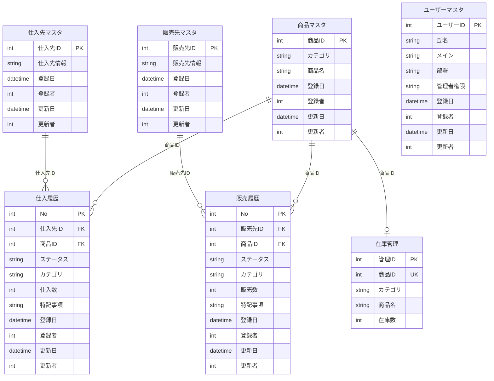

# 商品・在庫管理アプリ

## 1. 概要

### アプリの概要

商品・在庫管理を行うためのWebアプリケーション。
商品の情報や仕入先・販売先の情報を管理し、仕入・販売の履歴をもとに在庫を管理することを目的とする。

### 想定する利用者

一般社員を想定する。

### 解決したい課題

商品情報や仕入・販売の履歴を管理し、在庫管理に関する作業負担や手作業による入力ミスを減らすことを目指す。
また、在庫数を確認しながら仕入・販売の記録を管理することで、在庫不足や過剰な販売につながる操作を防ぐことを目指す。

### 起動手順

未記載。Dockerによる環境構築および起動確認後に記載する。

### 画面スクリーンショット

未作成。画面実装後に掲載する。

## 2. 設計

### 要件定義

#### 管理対象

- 商品情報
- 仕入先情報
- 販売先情報
- 仕入・販売の履歴

#### 主な機能・業務ルール

- 商品情報の登録・参照・更新・削除
- APIを通じたデータの登録・参照・更新・削除（CRUD）
- 仕入・販売の履歴をもとにした在庫管理
- 在庫数が0の商品は販売できないようにする
- 在庫数を超える販売を防止する
- 履歴の登録が成功した場合に在庫数を更新する
- 履歴の取消・修正による記録の管理
- 履歴の状態（新規・追加・修正・取消など）の管理
- 備考欄による補足情報の記録

#### 今回の対象外・優先度を下げる機能

- 承認フローなどの追加機能
- その他、必須要件の実装を優先するための追加機能

※ 実装する機能と対象外とする機能は、最終的な実装範囲に合わせて更新する。

### システム構成

使用技術として、React、TypeScript、Python、FastAPI、PostgreSQL、Dockerを予定している。
Docker Composeを利用し、フロントエンド・バックエンド・データベースの3コンテナ構成を目指す。
コンテナ間の通信方法やデータの処理経路については、環境構築および実装を通じて整理し、構成図を作成する。

### ER図

本アプリで管理するデータと、テーブル間の関連を以下に示す。

※登録者・更新者はユーザーマスタのユーザーIDを参照する想定。元の図の注記に合わせ、ここでは関連線を省略している。

### API一覧

APIの設計・実装後に、エンドポイント、HTTPメソッド、処理内容などを整理して記載する。

## 3. 技術の理解と振り返り

### 使用技術と選定理由

- React：フロントエンドの画面構築に使用する。
- TypeScript：Reactによる開発で使用する。
- Python：バックエンドの開発に使用する。
- FastAPI：APIを実装するために使用する。
- PostgreSQL：データを保存・管理するために使用する。
- Docker：各コンポーネントの実行環境を構築するために使用する。
- Docker Compose：3つのコンテナをまとめて管理するために使用する。

各技術の具体的な役割や選定理由、コンテナ間通信、APIとDBの連携については、開発を通じて理解した内容を自分の言葉で追記する。

### 開発中に詰まった点と解決方法

現時点で記録する内容は、次のとおりです。

- 詰まった点： アプリの概要や要件を整理し、ER図などの設計資料に落とし込むこと。
- 具体的な内容： 業務上の要件を整理し、データの構造やテーブル間の関係を図として表現することに難しさを感じた。
- 原因の調べ方・解決方法： 今後の設計作業を通じて整理する。
- 学んだこと： 開発を進めながら振り返り、最終的に記載する。
  ※解決方法や学んだことは、実際の経験が増えてから追記します。現時点で解決したことにしてしまわないようにします。

### 今回の開発で学んだこと

開発を通じて理解できた技術や、設計・実装で得られた知識を記載する。

### 未完成の部分・既知の不具合・今後の改善点

最終的な実装状況を確認し、未完成の機能、不具合、今後改善したい点を記載する。

### 作業時間

設計、環境構築、実装、テスト、README作成などの作業時間を記録し、おおよその合計時間を記載する。

## 4. 生成AIの利用について

### 生成AIの利用について

開発初期の設計・環境構築において、生成AIを相談相手として利用した。

- フォルダ構成の検討にあたり、フロントエンド・バックエンド・データベースの役割分担について助言を受けた。

フォルダ構成や環境構築の進め方について助言を受けたが、現段階ではアプリケーションのコード生成や機能実装には利用していない。
