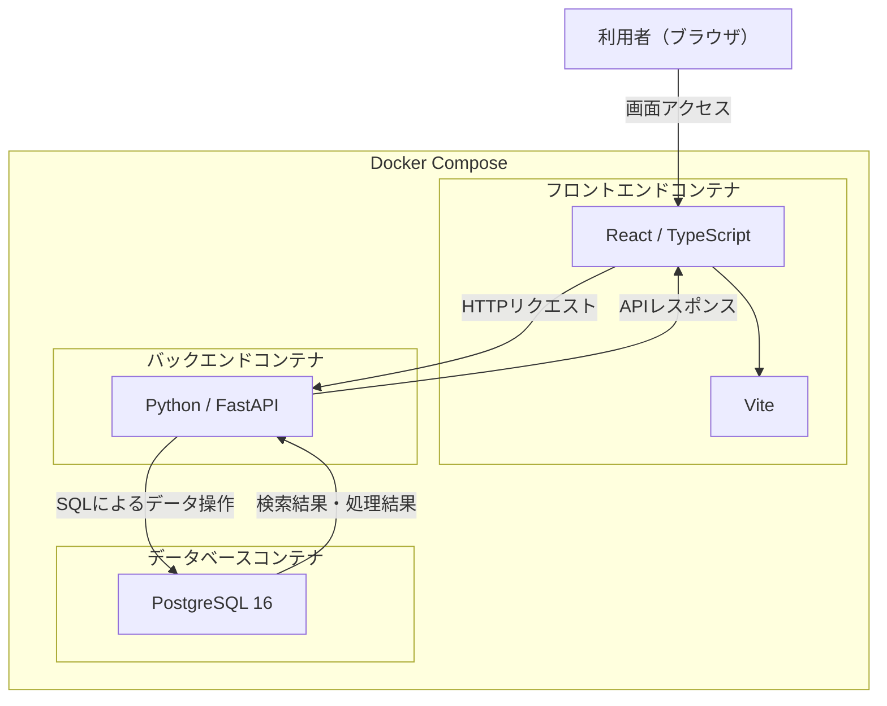
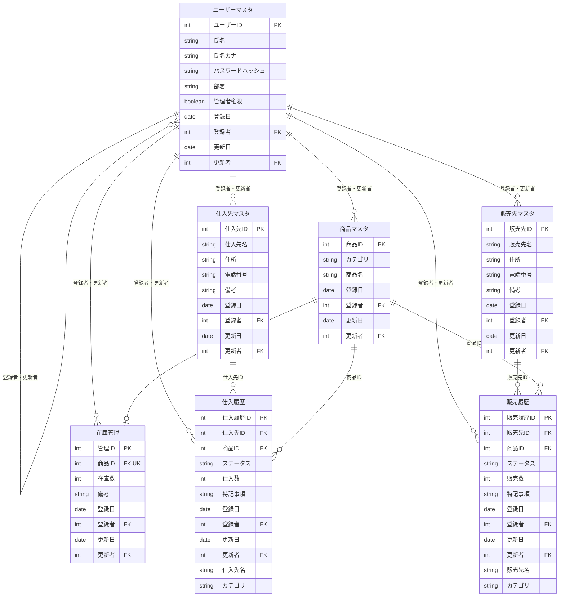

# 商品・在庫管理アプリ

## 1. 概要

### アプリの概要

商品・在庫管理を行うためのWebアプリケーション。

商品の情報や仕入先・販売先の情報を管理し、仕入・販売の履歴をもとに在庫を管理することを目的とする。

### 想定する利用者

一般社員を想定する。

### 解決したい課題

商品情報や仕入・販売の履歴を一元管理し、在庫管理に関する作業負担や手作業による入力ミスを減らすことを目指す。

また、在庫数を確認しながら仕入・販売の記録を管理することで、在庫不足や過剰な販売につながる操作を防止することを目指す。

### 起動手順

DockerおよびDocker Composeを使用して、フロントエンド・バックエンド・データベースの3コンテナを起動する。

#### 起動方法

1. プロジェクトのルートディレクトリに移動する。
2. `.env.example` を参考に `.env` を作成し、必要な環境変数を設定する。
3. 以下のコマンドで各サービスを起動する。

```bash
docker compose up -d --build
```

#### アクセス先

| サービス       | URL・ポート            | 用途                       |
| -------------- | ---------------------- | -------------------------- |
| フロントエンド | http://localhost:5173/ | Web画面                    |
| バックエンド   | http://localhost:8000/ | API                        |
| データベース   | 5432                   | PostgreSQL（コンテナ内部） |

#### 停止方法

```bash
docker compose down
```

※データベースの永続化ボリュームを保持するため、通常の停止では `-v` を指定しない。

### 画面スクリーンショット

画面の実装・動作確認後に掲載する。

---

## 2. 設計

### 要件定義

#### 管理対象

- 商品情報
- 仕入先情報
- 販売先情報
- 在庫情報
- 仕入・販売の履歴
- ユーザー情報

#### 主な機能・業務ルール

- 商品情報の登録・参照・更新・削除
- 仕入先情報の登録・参照・更新・削除
- 販売先情報の登録・参照・更新・削除
- APIを通じたデータの登録・参照・更新・削除（CRUD）
- 仕入・販売の履歴をもとにした在庫管理
- 在庫数が0の商品は販売できないようにする
- 在庫数を超える販売を防止する
- 履歴の登録が成功した場合に在庫数を更新する
- 履歴の修正・取消による記録の管理
- 履歴の状態（新規・追加・修正・取消など）の管理
- 備考欄による補足情報の記録

#### 今回の対象外・優先度を下げる機能

- 承認フローなどの追加機能
- 必須要件の実装を優先するための追加機能

※実装する機能と対象外とする機能は、最終的な実装範囲に合わせて更新する。

### システム構成

フロントエンド・バックエンド・データベースを分離し、Docker Composeを利用した3コンテナ構成とする。

#### 使用技術

| コンポーネント | 使用技術                  | 役割                                            |
| -------------- | ------------------------- | ----------------------------------------------- |
| フロントエンド | React / TypeScript / Vite | 画面表示、ユーザー操作、APIへのリクエスト       |
| バックエンド   | Python / FastAPI          | API処理、業務ルールの適用、データベースとの連携 |
| データベース   | PostgreSQL 16             | 商品・在庫などのデータ保存・管理                |
| コンテナ管理   | Docker / Docker Compose   | 各サービスの実行環境構築・管理                  |

#### システム構成図



フロントエンドからバックエンドのAPIへリクエストを送信し、バックエンドがデータベースとのデータの登録・参照・更新・削除などを行う。

処理結果はAPIのレスポンスとしてフロントエンドに返す。

#### フロントエンド

ReactとTypeScriptを使用して画面を構築する。

Viteは、開発サーバーの起動やビルドを簡単に行えるため採用した。

React Routerを使用し、URLに応じて表示するページを切り替える構成とした。

共通のヘッダーとサイドメニューを配置し、各ページのコンテンツを切り替える。

開発時はViteの開発サーバーを使用し、ブラウザから以下のURLにアクセスして画面を確認する。

- 開発用URL：http://localhost:5173/

#### バックエンド

PythonとFastAPIを使用してAPIを実装する。

APIを通じてデータの登録・参照・更新・削除を行えるようにし、必要に応じて業務ルールを適用する。

仕入・販売履歴の登録と在庫数の更新など、データの整合性を考慮した処理を実装する。

#### データベース

PostgreSQL 16を使用する。

商品情報や在庫情報などをテーブルで管理し、主キーや外部キーなどの制約を設定することで、データの整合性を保つ構成とする。

#### Dockerの設定

Docker Composeを使用して、フロントエンド・バックエンド・データベースの各サービスをまとめて管理する。

各Dockerfileでは、ベースイメージ、作業ディレクトリ、ファイルのコピー、依存関係のインストール、コンテナ起動時のコマンドなどを設定する。

フロントエンドでは、ホスト側のソースコードをコンテナ内に共有し、開発中のコード変更を反映できる構成とした。

各サービスのポート設定は以下のとおり。

| サービス       | ポート | 用途                       |
| -------------- | ------ | -------------------------- |
| フロントエンド | 5173   | 開発用Web画面              |
| バックエンド   | 8000   | API                        |
| データベース   | 5432   | PostgreSQL（コンテナ内部） |

データベースのパスワードなどの設定値は環境変数で管理し、`.env` ファイルはGitの管理対象から除外する。

### ER図

本アプリで管理するデータと、テーブル間の関連を以下に示す。



※登録者・更新者はユーザーマスタのユーザーIDを参照する。
※在庫管理の商品IDにはUNIQUE制約を設定し、1商品につき在庫情報を1件管理する。
※在庫数・仕入数・販売数には0未満の値を登録できない制約を設定する。

### API一覧

現在実装しているAPIのエンドポイント、HTTPメソッド、処理内容を以下に示す。

| エンドポイント | HTTPメソッド | 処理内容                         | 状況                   |
| -------------- | ------------ | -------------------------------- | ---------------------- |
| `/`            | GET          | APIの起動確認                    | 実装済み               |
| その他のAPI    | -            | 商品・仕入・販売などのデータ操作 | 実装状況に合わせて追記 |

※エンドポイントや処理内容は、実際のルーティング定義を確認して記載する。

### 使用技術と選定理由

#### React

フロントエンドの画面構築に使用するライブラリ。

コンポーネント単位で画面を管理でき、機能ごとに分けて開発しやすいため採用した。

#### TypeScript

JavaScriptに静的な型付けを追加した言語。

変数や関数などのデータ型を明確にでき、開発時のミスを防ぎやすくなるため採用した。

#### Vite

フロントエンドの開発環境を構築するツール。

開発サーバーの起動や変更内容の反映が容易であり、Reactと組み合わせて使用できるため採用した。

#### React Router

Reactアプリケーションで画面遷移を管理するためのライブラリ。

URLに応じて表示するコンポーネントを切り替えられるため採用した。

#### Python

バックエンドの開発言語。

FastAPIと組み合わせてAPIを実装するために使用する。

#### FastAPI

PythonでAPIを実装するためのWebフレームワーク。

APIの定義やリクエスト・レスポンスの処理を実装できるため採用した。

#### PostgreSQL

データをテーブル形式で管理するリレーショナルデータベース。

主キーや外部キーなどの制約を設定でき、テーブル間の関連を管理できるため採用した。

#### Docker / Docker Compose

各サービスの実行環境をコンテナとして構築・管理するために使用する。

Docker Composeを利用することで、フロントエンド・バックエンド・データベースの複数のサービスをまとめて起動・管理できる。

### 開発中に詰まった点と解決方法

#### Dockerによる開発環境の構築

Dockerを使用した開発環境の構築に取り組んだ。

フロントエンド・バックエンド・データベースをそれぞれ別のコンテナとして構成するため、各サービスの役割や設定、コンテナ間の接続について確認しながら進めた。

DockerfileやDocker Composeの設定を見直し、各サービスが動作するために必要な環境を整えた。

#### PostgreSQLのテーブル定義の修正

テーブル作成後、登録者・更新者の項目について、ユーザーマスタとの関連を考慮した定義に修正する必要があった。

`psql` の `\d` コマンドでテーブル構造を確認し、`ALTER TABLE` を使用してカラムの型や外部キー制約を修正した。

テーブル作成時の定義だけでなく、実際のデータベース上の構造を確認することの重要性を学んだ。

#### Dockerコンテナ内の依存関係の反映

React Routerを追加した際、ホスト側ではインストール済みであっても、Dockerコンテナ内からパッケージを読み込めない問題が発生した。

コンテナ内の `node_modules` がホスト側とは別に管理されていることを確認し、コンテナ内で依存関係をインストールした後、再ビルドすることで解消した。

ホスト側とコンテナ側でファイルや依存関係の管理が異なることを学んだ。

#### 在庫更新処理の実装

仕入・販売履歴の登録と在庫数の更新を連動させる処理を実装した。

履歴の登録が成功した後に在庫数を更新することや、販売時に在庫数を超えないようにすることなど、データの整合性を考慮しながら実装を進めた。

### 今回の開発で学んだこと

- Dockerfileでコンテナの実行環境を定義する方法
- Docker Composeで複数のサービスを管理する方法
- コンテナ間の通信やポート設定の考え方
- ホスト側とコンテナ側のファイル・依存関係の管理
- PostgreSQLでテーブルを作成・変更する方法
- 主キー・外部キーなどの制約によるデータの整合性の管理
- `ALTER TABLE` を使用したテーブル定義の変更
- 初期化SQLと実際のデータベース構造を一致させることの重要性
- Reactのコンポーネントによる画面構成
- React RouterによるURLと画面の紐付け
- フロントエンド・バックエンド・データベースの役割分担

### 未完成の部分・今後の改善点

- 商品情報のCRUD APIの実装・動作確認
- FastAPIとPostgreSQLの連携確認
- フロントエンドからAPIを呼び出す処理
- テストデータの登録
- 仕入・販売履歴の登録と在庫更新処理の動作確認
- 在庫数を超える販売を防止する処理の動作確認
- 必須機能の動作確認とテスト
- 各画面の入力・確認・完了処理の実装
- 画面の操作性の改善
- 起動手順と画面スクリーンショットの追加

※提出時点で完了していない項目を記載する。実装・動作確認が完了した項目は削除する。

### 作業時間

2026年10月15日から2026年11月4日までの作業時間を概算で記載する。

| 作業内容         |     作業時間 |
| ---------------- | -----------: |
| 要件定義・設計   |   約15.5時間 |
| 開発環境の構築   |   約24.5時間 |
| 実装             |   約12.5時間 |
| テスト・動作確認 |      約3時間 |
| README作成       |    約6.5時間 |
| **合計**         | **約62時間** |

※1日平均約3時間として算出した概算。実際の作業時間とは異なる場合がある。

## 3. 生成AIの利用について

開発全体を通して、生成AIを設計・環境構築・実装時の確認や問題解決などに利用した。

基本的には、自分で調べて考えた内容をもとに実際に作業や実行を行い、うまく動作しない場合や判断に迷う場合に、生成AIへ相談するという進め方を行った。

その際、単に解決方法を尋ねるのではなく、自分が考えた原因や解決方法、実現したい動きなどを文章で共有し、それをもとに問題点や改善方法について助言を受けた。回答を参考に修正・実行し、結果を確認するという試行錯誤を繰り返しながら開発を進めた。

また、自分が考えているシステムの構成や画面・機能の動きについて文章で共有し、内容を整理してもらうことで、設計や実装方針の確認にも活用した。

主な利用内容は以下のとおり。

- **開発環境の構成**
  - PythonやReactなどのバージョンの確認
  - 各サービスのポート設定やコンテナ間の接続方法の確認
  - Dockerを利用した開発環境の構成に関する相談

- **システム構成・動作の確認**
  - 自分で考えたフロントエンド・バックエンド・データベースの役割分担や処理の流れを文章で共有し、内容を整理
  - 想定しているシステム構成や実際の動作イメージを図にして共有し、構成や処理の流れに問題がないか確認

- **エラーの原因調査・解決**
  - 発生したエラーコードや実行結果を共有し、原因の特定や解決方法について相談
  - 自分で考えた原因や解決方法を提示し、それに対する助言を参考に修正・実行を繰り返した

- **実装時のコード作成・修正**
  - 仕入履歴と販売履歴は基本的な処理や画面構成が共通しているため、一方の実装をもとに、名称や項目などを変更したもう一方のコード作成を依頼し、実装時間の短縮に活用

- **READMEの作成**
  - 自分で整理した設計内容や開発内容を共有し、MarkdownやMermaidを使用した文書の体裁整理や文章の修正に活用

生成AIからの回答や作成されたコードをそのまま採用するのではなく、内容を確認し、自分の考えや実際の動作と照らし合わせながら修正・実行することを意識した。
