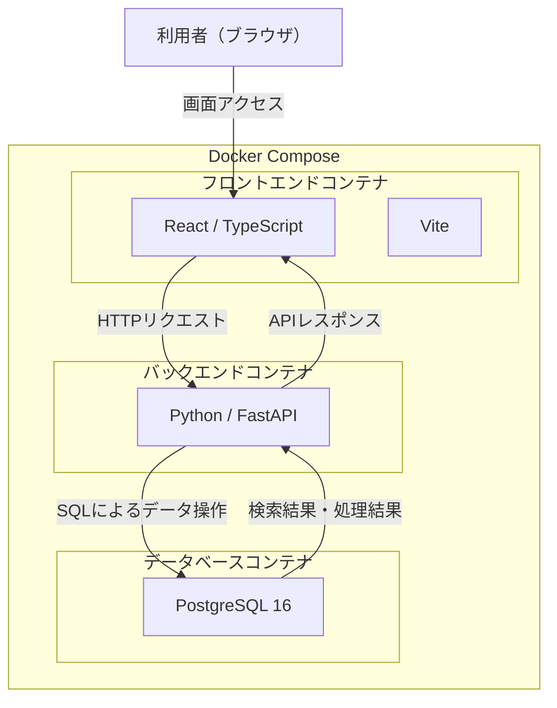
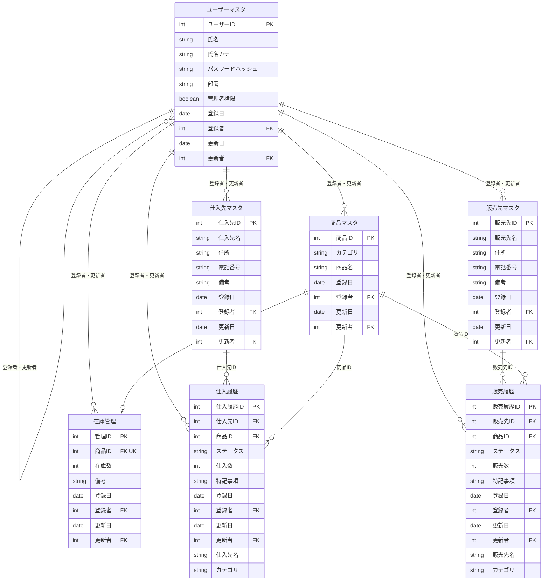
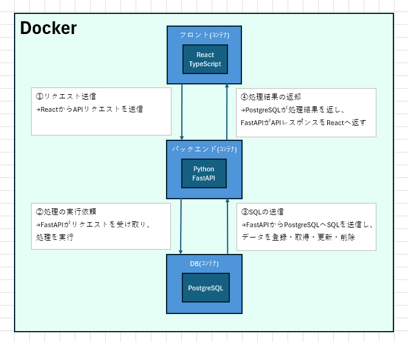

# 商品・在庫管理アプリ

## 1. 概要

### アプリの概要

商品・在庫管理を行うためのWebアプリケーション。
商品情報を登録・参照し、仕入・販売の履歴を管理することで、商品ごとの在庫状況を一元的に把握できることを目的とする。
仕入・販売の登録内容に応じて在庫数を自動的に増減させる仕組みを設け、在庫情報と取引履歴を連動させて管理する。
また、仕入・販売履歴の更新やキャンセルにも対応し、変更内容に応じて在庫数を調整することで、継続的に正確な在庫管理を行えるようにする。

### 想定する利用者

一般社員を想定する。
日常業務において、商品の登録や仕入・販売情報の入力、在庫状況の確認などを行う社員を対象とする。
専門的な在庫管理システムの操作に慣れていない社員でも、商品情報や取引履歴を確認しながら、仕入・販売に伴う在庫管理を行えることを想定している。

### 解決したい課題

従来の在庫管理では、商品情報や仕入・販売履歴が分散している場合、必要な情報の確認に時間がかかるほか、手作業による在庫数の更新に伴う入力ミスや更新漏れが発生する可能性がある。
本アプリケーションでは、商品情報と仕入・販売履歴を一元的に管理し、取引内容に応じて在庫数を自動更新することで、手作業による管理負担の軽減と入力ミスの抑制を目指す。
また、以下のような課題への対応を目的とする。

- **在庫数の更新漏れ・入力ミス**：仕入・販売の登録内容に応じて在庫数を自動更新する。
- **在庫数を超える販売**：在庫数が0の場合や、販売数量が在庫数を超える場合は販売できないようにする。
- **取引内容の変更による在庫数の不整合**：仕入・販売履歴の修正やキャンセル時に、変更内容に応じて在庫数を調整する。
- **在庫情報の管理負担**：商品ごとの在庫数を一覧で確認できるようにし、在庫数が0の商品については在庫データを削除できるようにする。
  これらの機能により、日常的な仕入・販売業務と在庫管理を連動させ、在庫情報の正確性と業務効率の向上を目指す。

### 起動手順

本アプリケーションは、DockerおよびDocker Composeを使用して動作する。
フロントエンド・バックエンド・データベースの3つのコンテナで構成されており、Docker Composeを利用することで、各サービスをまとめて起動・停止できる。

### 事前準備

起動前に、以下の環境を用意する。

- Docker Desktop
- Docker Compose（Docker Desktopに付属）

また、プロジェクトのソースコードをローカル環境に取得しておく。

### 起動方法

1. プロジェクトのルートディレクトリに移動する。

2. プロジェクトのルートディレクトリに `.env` ファイルを作成する。

3. `.env` ファイルにPostgreSQLのパスワードを設定する。

   ```env
   POSTGRES_PASSWORD=設定するパスワード
   ```

### 画面スクリーンショット

docs/images/
├── screen-home-after-login.png
├── screen-home-before-login.png
├── screen-inventory-confirm-complete.png
├── screen-inventory-confirm.png
├── screen-inventory.png
├── screen-login.png
├── screen-product-complete.png
├── screen-product-create.png
├── screen-product-edit.png
├── screen-purchase-create-complete.png
├── screen-purchase-create-confirm.png
├── screen-purchase-create.png
├── screen-purchase-history-cancel-complete.png
├── screen-purchase-history-cancel-confirm.png
├── screen-purchase-history-complete-confirm.png
├── screen-purchase-history-confirm.png
├── screen-purchase-history-edit.png
├── screen-purchase-history.png
├── screen-sales-create-complete.png
├── screen-sales-create-confirm.png
├── screen-sales-create.png
├── screen-sales-history-complete.png
├── screen-sales-history-confirm.png
└── screen-sales-history-edit.png

[画面スクリーンショット一覧](docs/images/)

---

## 2. 設計

### 要件定義

#### 管理対象

- 商品情報
- 仕入先情報
- 販売先情報
- 在庫情報
- 仕入・販売履歴
- ユーザー情報

#### 主な機能・業務ルール

- 商品情報の登録・参照・更新・削除
- 仕入先・販売先情報の参照
- 在庫情報の参照・更新・削除
- 仕入・販売履歴の登録・参照・更新・取消
- APIを通じたデータの登録・参照・更新・削除（CRUD）
- 仕入・販売履歴に応じた在庫数の自動更新
- 在庫数が0の場合は販売できないようにする
- 在庫数を超える販売を防止する
- 履歴の登録が成功した場合に在庫数を更新する
- 履歴の修正・取消時に、変更内容に応じて在庫数を調整する
- 履歴の状態（新規・追加・修正・取消）の管理
- 備考欄による補足情報の記録
- 在庫数が0の商品に限り、在庫データを削除できるようにする

#### 今回の対象外・未実装機能

- 承認フロー
- 新商品モデルへの対応
- 認証機能
- テストコード
- AI機能

※必須要件の実装を優先し、追加機能については今回の実装対象外とした。

### システム構成

フロントエンド・バックエンド・データベースを分離し、Docker Composeを利用した3コンテナ構成とする。

#### 使用技術

| コンポーネント | 使用技術                  | 役割                                            |
| -------------- | ------------------------- | ----------------------------------------------- |
| フロントエンド | React / TypeScript / Vite | 画面表示、ユーザー操作、APIへのリクエスト       |
| バックエンド   | Python / FastAPI          | API処理、業務ルールの適用、データベースとの連携 |
| データベース   | PostgreSQL 16             | 商品・在庫・取引履歴などのデータ保存・管理      |
| コンテナ管理   | Docker / Docker Compose   | 各サービスの実行環境構築・管理                  |

#### システム構成図



フロントエンドからバックエンドのAPIへリクエストを送信し、バックエンドがデータベースとのデータの登録・参照・更新・削除などを行う。
処理結果はAPIのレスポンスとしてフロントエンドに返す。

#### フロントエンド

ReactとTypeScriptを使用して、商品・在庫管理を行うWeb画面を構築する。
Reactは、画面をコンポーネント単位で管理でき、共通部分の再利用やページごとの機能分割がしやすいため採用した。
TypeScriptは、JavaScriptに静的な型定義を加えることで、データの型や関数の引数・戻り値などを明確にでき、開発時のミスを防ぎやすくするため採用した。
Viteは、開発サーバーの起動やビルドを簡単に行えるほか、変更内容をブラウザに素早く反映できるため採用した。
画面遷移にはReact Routerを使用し、URLに応じて表示するページを切り替える構成とした。
また、共通のヘッダーとサイドメニューを配置し、各ページで共通のレイアウトを利用できるようにしている。

主な画面機能は以下のとおり。

- ログイン・ログアウト
- ホーム画面
- 商品情報の登録
- 在庫情報の参照・削除
- 仕入履歴の登録・参照・更新・取消
- 販売履歴の登録・参照・更新・取消

各画面から入力された情報は、HTTPリクエストを通じてバックエンドのAPIへ送信する。APIから返された処理結果をもとに、画面の表示やメッセージを更新する。

開発時はViteの開発サーバーを使用し、以下のURLから画面にアクセスする。

- 開発用URL：[http://localhost:5173/](http://localhost:5173/)

#### バックエンド

PythonとFastAPIを使用して、フロントエンドからのリクエストを処理するAPIを実装する。
FastAPIは、PythonでAPIを比較的簡潔に実装でき、リクエストやレスポンスのデータ形式を定義しやすいことから採用した。
バックエンドでは、フロントエンドから受け取ったリクエストに対して、入力内容の確認や業務ルールの適用を行い、データベースとのデータの登録・参照・更新・削除を行う。

処理は主に以下の役割に分けて実装している。

- **Router**：APIのエンドポイントを定義し、リクエストを受け付ける。
- **Service**：業務ルールや処理の流れを管理する。
- **Repository**：データベースへのSQL発行やデータの取得・更新を行う。

また、商品・仕入・販売・在庫などの機能ごとに処理を分け、役割に応じて管理できる構成とした。
特に、仕入・販売履歴と在庫数の整合性を保つため、以下の処理を実装している。

- 仕入履歴の登録が成功した場合、仕入数量に応じて在庫数を増加させる。
- 販売履歴の登録時は、在庫数を確認し、在庫数が0の場合や販売数量が在庫数を超える場合は登録できないようにする。
- 販売履歴の登録が成功した場合、販売数量に応じて在庫数を減少させる。
- 仕入・販売履歴の修正や取消時は、変更内容に応じて在庫数を調整する。
- 在庫数が残っている場合は、在庫データを削除できないようにする。

データベースで発生した処理結果やエラー内容は、APIのレスポンスとしてフロントエンドに返す。
また、FastAPIが提供するSwagger UIを利用して、APIのエンドポイントやリクエスト・レスポンスの仕様を確認できるようにしている。

- APIドキュメント：[http://localhost:8000/docs](http://localhost:8000/docs)

#### データベース

PostgreSQL 16を使用して、アプリケーションで扱うデータを管理する。
PostgreSQLは、リレーショナルデータベースとしてテーブル間の関連性や制約を設定でき、複数のデータを整合性を保ちながら管理できるため採用した。
主な管理対象は以下のとおり。

- 商品情報
- 仕入先情報
- 販売先情報
- 在庫情報
- 仕入履歴
- 販売履歴
- ユーザー情報

各データはテーブル単位で管理し、主キーや外部キーなどを設定することで、テーブル間の関連性を明確にしている。
また、商品ごとに在庫データを管理し、仕入・販売履歴と在庫数を連動させる構成とした。
仕入・販売履歴の登録や更新、取消に伴う在庫数の変更では、データの不整合が発生しないよう、関連するデータベース処理をトランザクションで管理する。
データベースはDocker Composeによってコンテナとして起動し、PostgreSQLのデータは名前付きボリュームを使用して永続化する。
これにより、コンテナを停止・再起動した場合でも、通常の停止操作ではデータが保持される構成としている。

#### Dockerの設定

Docker Composeを使用して、フロントエンド・バックエンド・データベースの各サービスをまとめて管理する。
各Dockerfileでは、ベースイメージ、作業ディレクトリ、ファイルのコピー、依存関係のインストール、コンテナ起動時のコマンドなどを設定する。
フロントエンドでは、ホスト側のソースコードをコンテナ内に共有し、開発中のコード変更を反映できる構成とした。

各サービスのポート設定は以下のとおり。
| サービス | ポート | 用途 |
| -------------- | ------ | -------------------------- |
| フロントエンド | 5173 | 開発用Web画面 |
| バックエンド | 8000 | API |
| データベース | 5432 | PostgreSQL（コンテナ内部） |

データベースのパスワードなどの設定値は環境変数で管理し、`.env` ファイルはGitの管理対象から除外する。

### ER図

本アプリケーションで管理するデータと、テーブル間の関連を以下に示す。



※登録者・更新者にはユーザーマスタのユーザーIDを設定し、登録・更新を行ったユーザーを管理する。
※在庫管理テーブルの商品IDにはUNIQUE制約を設定し、1商品につき在庫情報を1件のみ管理する。
※在庫数・仕入数・販売数には、0未満の値を登録できない制約を設定する。

### API一覧

本アプリケーションで実装しているAPIのエンドポイント、HTTPメソッド、処理内容を以下に示す。

#### 商品情報

| エンドポイント           | HTTPメソッド | 処理内容     |
| ------------------------ | ------------ | ------------ |
| `/products`              | GET          | 商品一覧取得 |
| `/products`              | POST         | 商品登録     |
| `/products/{product_id}` | GET          | 商品詳細取得 |
| `/products/{product_id}` | PUT          | 商品情報更新 |
| `/products/{product_id}` | DELETE       | 商品削除     |

#### 仕入先情報

| エンドポイント             | HTTPメソッド | 処理内容       |
| -------------------------- | ------------ | -------------- |
| `/suppliers`               | GET          | 仕入先一覧取得 |
| `/suppliers`               | POST         | 仕入先登録     |
| `/suppliers/{supplier_id}` | PUT          | 仕入先情報更新 |
| `/suppliers/{supplier_id}` | DELETE       | 仕入先削除     |

#### 販売先情報

| エンドポイント             | HTTPメソッド | 処理内容       |
| -------------------------- | ------------ | -------------- |
| `/customers`               | GET          | 販売先一覧取得 |
| `/customers`               | POST         | 販売先登録     |
| `/customers/{customer_id}` | PUT          | 販売先情報更新 |
| `/customers/{customer_id}` | DELETE       | 販売先削除     |

#### 在庫情報

| エンドポイント                | HTTPメソッド | 処理内容       |
| ----------------------------- | ------------ | -------------- |
| `/inventories`                | GET          | 在庫一覧取得   |
| `/inventories/{inventory_id}` | DELETE       | 在庫データ削除 |

#### 仕入履歴

| エンドポイント                           | HTTPメソッド | 処理内容           |
| ---------------------------------------- | ------------ | ------------------ |
| `/purchase/history`                      | GET          | 仕入履歴一覧取得   |
| `/purchase/history`                      | POST         | 仕入履歴登録・更新 |
| `/purchase/history/{purchase_id}/cancel` | POST         | 仕入履歴キャンセル |

#### 販売履歴

| エンドポイント                     | HTTPメソッド | 処理内容           |
| ---------------------------------- | ------------ | ------------------ |
| `/sales/history`                   | GET          | 販売履歴一覧取得   |
| `/sales/history`                   | POST         | 販売履歴登録・更新 |
| `/sales/history/{sales_id}/cancel` | POST         | 販売履歴キャンセル |

#### ユーザー情報・認証

| エンドポイント     | HTTPメソッド | 処理内容         |
| ------------------ | ------------ | ---------------- |
| `/users/{user_id}` | GET          | ユーザー情報取得 |
| `/login`           | POST         | ログイン認証     |

### 使用技術と選定理由

#### React

フロントエンドの画面構築に使用するライブラリ。
課題で指定された技術であり、コンポーネント単位で画面を管理できるため、機能ごとに分けて開発しやすい。

#### TypeScript

JavaScriptに静的な型付けを追加した言語。
変数や関数などのデータ型を明確にでき、開発時のミスを防ぎやすくなるため使用した。

#### Vite

フロントエンドの開発環境を構築するツール。
開発サーバーの起動やソースコードの変更内容の反映を容易に行えるため使用した。

#### React Router

Reactアプリケーションで画面遷移を管理するためのライブラリ。
URLに応じて表示するコンポーネントを切り替えるために使用した。

#### Python

バックエンドの開発言語。
課題で指定された技術であり、FastAPIと組み合わせてAPIを実装するために使用した。

#### FastAPI

PythonでAPIを実装するためのWebフレームワーク。
課題で指定された技術であり、フロントエンドからのリクエストを受け取り、入力内容や業務ルールに応じた処理を行うために使用した。

#### PostgreSQL

データをテーブル形式で管理するリレーショナルデータベース。
課題で指定された技術であり、商品情報や在庫情報、仕入・販売履歴などのデータを管理するために使用した。

#### Docker / Docker Compose

フロントエンド・バックエンド・データベースの実行環境を、それぞれ独立したコンテナとして構築・管理するために使用した。
課題で指定された3つのコンテナ構成に加え、サービスごとに管理できる点にメリットがあると考えた。
例えば、特定のサービスだけを起動・再起動したり、コンテナごとにログを確認したりできるため、問題が発生した際にも原因を特定しやすいと考えた。
また、Docker Composeを利用することで、複数のコンテナをまとめて起動・停止できる。

### コンテナ間の通信とAPI・データベースの連携

システムは、フロントエンド・バックエンド・データベースの3つのコンテナで構成している。
フロントエンドからバックエンドのAPIへHTTPリクエストを送信し、バックエンドでリクエストの内容に応じた処理を行う。
バックエンドでは、必要に応じてSQLを使用してデータベースにアクセスし、データの登録・参照・更新・削除を行う。
データベースから取得した結果や処理結果はバックエンドに返され、APIレスポンスとしてフロントエンドに返すことで、画面に処理結果を反映する。
システム全体の構成と通信の流れを以下に示す。


### 開発中に詰まった点と解決方法

#### Dockerによる開発環境の構築

Dockerを使用した開発環境の構築に取り組んだ。
Dockerの使用経験が少なく、各技術のバージョンや初期構築時に必要なファイル・設定など、何を準備すればよいか判断することが難しかった。
そのため、必要な構成や設定を調べ、Viteを使用したフロントエンド環境などを構築しながら、動作状況に応じて設定を見直した。
また、フロントエンド・バックエンド・データベースをそれぞれ別のコンテナとして構成するため、各サービスの役割やコンテナ間の接続についても確認しながら進めた。

#### PostgreSQLのテーブル定義の修正

テーブル作成後、登録者・更新者の項目について、ユーザーマスタとの関連を考慮した定義に修正する必要があった。
`psql` の `\d` コマンドでテーブル構造を確認し、`ALTER TABLE` を使用してカラムの型や外部キー制約を修正した。
テーブル作成時の定義だけでなく、実際のデータベース上の構造を確認することの重要性を学んだ。

#### Dockerコンテナ内の依存関係の反映

React Routerを追加した際、ホスト側ではインストール済みであっても、Dockerコンテナ内からパッケージを読み込めない問題が発生した。
コンテナ内の `node_modules` がホスト側とは別に管理されていることを確認し、コンテナ内で依存関係をインストールした後、再ビルドすることで解消した。
ホスト側とコンテナ側でファイルや依存関係の管理が異なることを学んだ。

#### 在庫更新処理の実装

仕入・販売履歴の登録と在庫数の更新を連動させる処理を実装した。
履歴の登録が成功した後に在庫数を更新することや、販売時に在庫数を超えないようにすることなど、履歴と在庫の整合性を考慮しながら実装を進めた。

### 今回の開発で学んだこと

#### Docker・開発環境

- Dockerfileでコンテナの実行環境を定義する方法
- Docker Composeで複数のサービスを管理する方法
- コンテナ間の通信やポート設定の考え方
- ホスト側とコンテナ側のファイル・依存関係の管理

#### データベース

- PostgreSQLでテーブルを作成・変更する方法
- 主キー・外部キーなどの制約によるデータの整合性の管理
- `ALTER TABLE` を使用したテーブル定義の変更
- 初期化SQLと実際のデータベース構造を一致させることの重要性

#### フロントエンド

- Reactのコンポーネントによる画面構成
- React RouterによるURLと画面の紐付け

#### システム全体の構成

- フロントエンド・バックエンド・データベースの役割分担
- APIを通じたフロントエンドとバックエンドの連携
- バックエンドを介したデータベースとのデータ連携

#### 開発の進め方

- 要件定義を明確にし、開発全体の軸を持つことの重要性
- 実装時に発生した課題に対して、仕様や目的に立ち返って改善すること
- 生成AIの提案をそのまま採用せず、自分の要件や意図に照らして判断すること

### 未完成の部分・今後の改善点

今回の開発では、限られた期間内で基本的な商品・在庫管理機能を実装することを優先した。
そのため、認証機能のさらなる充実や、長期間在庫がない商品に対して削除を促す機能など、利便性を高めるための機能については実装を見送った。
また、当初は実現したいと考えていた機能の中にも、開発時間の都合から簡素化したものがある。
今後は、認証機能の改善や在庫管理機能の充実、画面の操作性の改善など、利用者にとってより使いやすいアプリケーションになるよう、継続してブラッシュアップしていきたい。

### 作業時間

2026年10月15日から2026年11月4日までの作業時間を概算で記載する。
| 作業内容 | 作業時間 |
| ---------------- | -----------: |
| 要件定義・設計 | 約15.5時間 |
| 開発環境の構築 | 約24.5時間 |
| 実装 | 約12.5時間 |
| テスト・動作確認 | 約3時間 |
| README作成 | 約6.5時間 |
| **合計** | **約62時間** |
※1日平均約3時間として算出した概算。実際の作業時間とは異なる場合がある。

## 3. 生成AIの利用について

開発全体を通して、生成AIを設計・環境構築・実装時の確認や問題解決などに利用した。

基本的には、自分で調べて考えた内容をもとに作業や実行を行い、うまく動作しない場合や判断に迷う場合に、生成AIへ相談するという進め方を行った。

その際、単に解決方法を尋ねるのではなく、自分が考えた原因や解決方法、実現したい動きなどを文章で共有し、それをもとに問題点や改善方法について助言を受けた。回答を参考に修正・実行し、結果を確認するという試行錯誤を繰り返しながら開発を進めた。

また、自分が考えているシステムの構成や画面・機能の動きについて文章や図で共有し、内容を整理してもらうことで、設計や実装方針の確認にも活用した。

主な利用内容は以下のとおり。

- **開発環境の構成**
  - PythonやReactなどのバージョンの確認
  - 各サービスのポート設定やコンテナ間の接続方法の確認
  - Dockerを利用した開発環境の構成に関する相談

- **システム構成・動作の確認**
  - 自分で考えたフロントエンド・バックエンド・データベースの役割分担や処理の流れを文章で共有し、内容を整理
  - 想定しているシステム構成や実際の動作イメージを図にして共有し、構成や処理の流れに問題がないか確認

- **エラーの原因調査・解決**
  - 発生したエラーコードや実行結果を共有し、原因の特定や解決方法について相談
  - 自分で考えた原因や解決方法を提示し、それに対する助言を参考に修正・実行を繰り返した

- **実装時のコード作成・修正**
  - 仕入履歴と販売履歴は基本的な処理や画面構成が共通しているため、一方の実装をもとに、名称や項目などを変更したもう一方のコード作成を依頼し、実装時間の短縮に活用
  - 提案されたコードを既存の構成や処理内容と照らし合わせ、必要に応じて修正・調整

- **READMEの作成**
  - 自分で整理した設計内容や開発内容を共有し、MarkdownやMermaidを使用した文書の体裁整理や文章の修正に活用

生成AIからの回答や作成されたコードをそのまま採用するのではなく、内容を確認し、自分の考えや実際の動作と照らし合わせながら修正・実行することを意識した。
