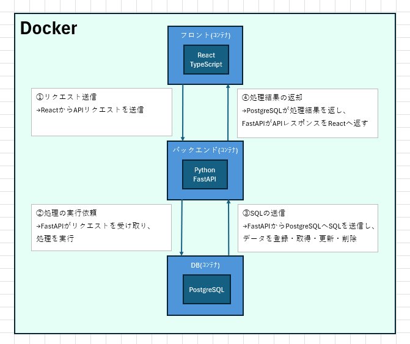
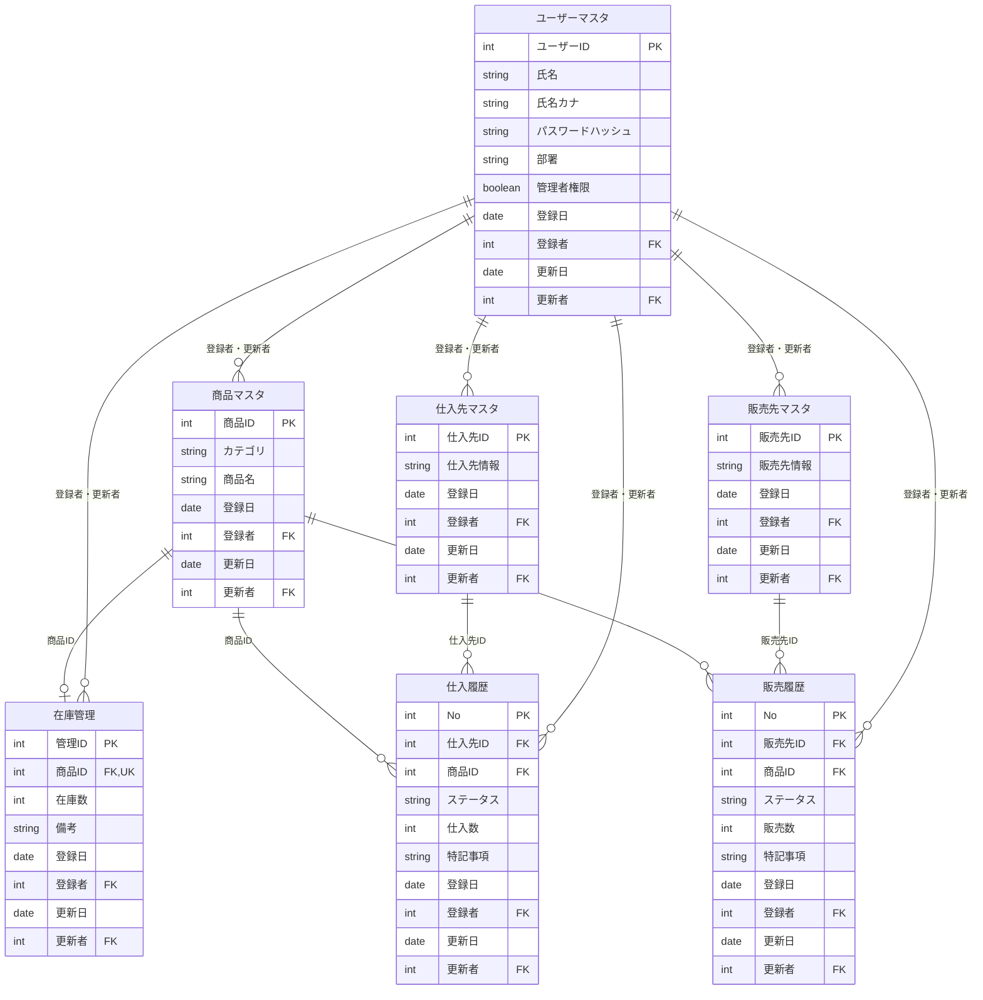
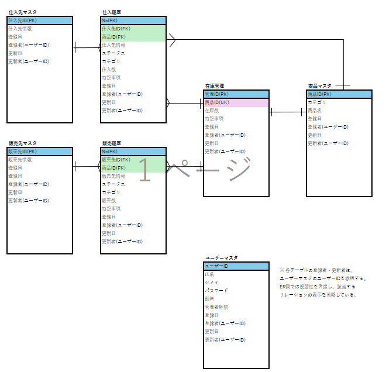

# 商品・在庫管理アプリ

## 1. 概要

### アプリの概要

商品・在庫管理を行うためのWebアプリケーション。

商品の情報や仕入先・販売先の情報を管理し、仕入・販売の履歴をもとに在庫を管理することを目的とする。

### 想定する利用者

一般社員を想定する。

### 解決したい課題

商品情報や仕入・販売の履歴を管理し、在庫管理に関する作業負担や手作業による入力ミスを減らすことを目指す。

また、在庫数を確認しながら仕入・販売の記録を管理することで、在庫不足や過剰な販売につながる操作を防ぐことを目指す。

### 起動手順

DockerおよびDocker Composeを使用して、フロントエンド・バックエンド・データベースを起動する。

開発環境の構築と起動確認は進行中。各サービスの起動方法および動作確認手順は、実装の進捗に合わせて追記する。

### 画面スクリーンショット

未作成。画面実装後に掲載する。

---

## 2. 設計

### 要件定義

#### 管理対象

- 商品情報
- 仕入先情報
- 販売先情報
- 在庫情報
- 仕入・販売の履歴
- ユーザー情報

#### 主な機能・業務ルール

- 商品情報の登録・参照・更新・削除
- 仕入先情報の登録・参照・更新・削除
- 販売先情報の登録・参照・更新・削除
- APIを通じたデータの登録・参照・更新・削除（CRUD）
- 仕入・販売の履歴をもとにした在庫管理
- 在庫数が0の商品は販売できないようにする
- 在庫数を超える販売を防止する
- 履歴の登録が成功した場合に在庫数を更新する
- 履歴の取消・修正による記録の管理
- 履歴の状態（新規・追加・修正・取消など）の管理
- 備考欄による補足情報の記録

#### 今回の対象外・優先度を下げる機能

- 承認フローなどの追加機能
- その他、必須要件の実装を優先するための追加機能

※実装する機能と対象外とする機能は、最終的な実装範囲に合わせて更新する。

### システム構成

フロントエンド・バックエンド・データベースを分離し、Docker Composeを利用した3コンテナ構成とする。

使用技術は以下のとおり。

| コンポーネント | 使用技術                  | 役割                                            |
| -------------- | ------------------------- | ----------------------------------------------- |
| フロントエンド | React / TypeScript / Vite | 画面表示、ユーザー操作、APIへのリクエスト       |
| バックエンド   | Python / FastAPI          | API処理、業務ルールの適用、データベースとの連携 |
| データベース   | PostgreSQL 16             | 商品・在庫などのデータ保存・管理                |
| コンテナ管理   | Docker / Docker Compose   | 各サービスの実行環境構築・管理                  |

フロントエンドからバックエンドのAPIへリクエストを送信し、バックエンドがデータベースとのデータの登録・参照・更新・削除などを行う。処理結果はAPIのレスポンスとしてフロントエンドに返す。

#### フロントエンド

ReactとTypeScriptを使用して画面を構築する。

Viteは、開発サーバーの起動やビルドを簡単に行えるため採用した。

開発時はViteの開発サーバーを使用し、ブラウザから以下のURLにアクセスして画面を確認する。

- 開発用URL：http://localhost:5173/

#### バックエンド

PythonとFastAPIを使用してAPIを実装する。

APIを通じてデータの登録・参照・更新・削除を行えるようにし、必要に応じて業務ルールを適用する。

現在はFastAPIの起動とルートエンドポイントの実装を行っている。商品管理などのAPIは今後実装する。

#### データベース

PostgreSQL 16を使用する。

商品情報や在庫情報などをテーブルで管理し、主キーや外部キーなどの制約を設定することで、データの整合性を保つ構成とする。

#### Dockerの設定

Docker Composeを使用して、フロントエンド・バックエンド・データベースの各サービスをまとめて管理する。

各Dockerfileでは、ベースイメージ、作業ディレクトリ、ファイルのコピー、依存関係のインストール、コンテナ起動時のコマンドなどを設定する。

フロントエンドでは、ホスト側のソースコードをコンテナ内に共有し、開発中のコード変更を反映できる構成とした。

各サービスのポート設定は以下のとおり。

| サービス       | ポート | 用途                       |
| -------------- | ------ | -------------------------- |
| フロントエンド | 5173   | 開発用Web画面              |
| バックエンド   | 8000   | API                        |
| データベース   | 5432   | PostgreSQL（コンテナ内部） |

データベースのパスワードなどの設定値は環境変数で管理し、`.env` ファイルはGitの管理対象から除外する。

※構成図のファイル名・保存先は、実際の配置に合わせて更新する。

### ER図

本アプリで管理するデータと、テーブル間の関連を以下に示す。

以下は設計上の構成であり、すべてのテーブルが実装済みという意味ではない。

※登録者・更新者はユーザーマスタのユーザーIDを参照する想定。元の図の注記に合わせ、ここでは関連線を省略している。

### API一覧

現在はFastAPIのルートエンドポイントを実装している。

| エンドポイント | HTTPメソッド | 処理内容                         | 状況     |
| -------------- | ------------ | -------------------------------- | -------- |
| `/`            | GET          | APIの起動確認                    | 実装済み |
| 商品管理API    | 未定         | 商品情報の登録・参照・更新・削除 | 未実装   |

### 使用技術と選定理由

- React：フロントエンドの画面構築に使用する。
- TypeScript：Reactによる開発で使用する。
- Vite：フロントエンドの開発サーバー起動やビルドに使用する。
- Python：バックエンドの開発に使用する。
- FastAPI：APIを実装するために使用する。
- PostgreSQL：データを保存・管理するために使用する。
- Docker：各コンポーネントの実行環境を構築するために使用する。
- Docker Compose：フロントエンド・バックエンド・データベースの3サービスをまとめて管理するために使用する。

### 開発中に詰まった点と解決方法

#### Dockerによる開発環境の構築

DockerfileやDocker Composeの設定を行い、フロントエンド・バックエンド・データベースの各サービスを起動する構成を整えた。

#### データベースのテーブル構造の変更

PostgreSQLのテーブル構造を確認し、登録者・更新者のデータ型や、ユーザーマスタを参照する外部キーを設定した。

テーブル構造の確認には `psql` の `\d` コマンドを使用し、構造の変更には `ALTER TABLE` を使用した。

### 今回の開発で学んだこと

- Dockerfileでコンテナイメージの構築方法を定義すること。
- Docker Composeで複数のサービスをまとめて管理できること。
- PostgreSQLでテーブルの作成や構造の変更、制約の設定ができること。
- 外部キー制約によって、参照先のデータとの整合性を保てること。
- 初期化SQLと、実際に作成されたデータベースの構造を一致させる必要があること。

### 未完成の部分・今後の改善点

- 商品情報のCRUD APIの実装
- FastAPIとPostgreSQLの連携
- フロントエンドからAPIを呼び出す処理
- 仕入先・販売先・仕入履歴・販売履歴のテーブル作成
- 仕入・販売履歴に応じた在庫数の更新処理
- 在庫数を超える販売を防止する処理
- 必須機能の動作確認とテスト
- 起動手順と画面スクリーンショットの追加

### 作業時間

各作業の所要時間を記録し、最後に合計時間を記載する。

- 設計：未集計
- 環境構築：未集計
- 実装：未集計
- テスト：未集計
- README作成：未集計
- 合計：未集計

## 4. 生成AIの利用について

開発初期の設計・環境構築において、生成AIを相談相手として利用した。

- フォルダ構成や各コンポーネントの役割分担について助言を受けた。
- DockerおよびDocker Composeによる環境構築の進め方について助言を受けた。
- データベース設計や主キー・外部キーなどの考え方について相談した。
- READMEに記載する内容や、開発中に学んだことの整理に利用した。

生成AIから得た助言を参考にしながら、実際の設定やコマンドの実行結果を確認して開発を進めている。
